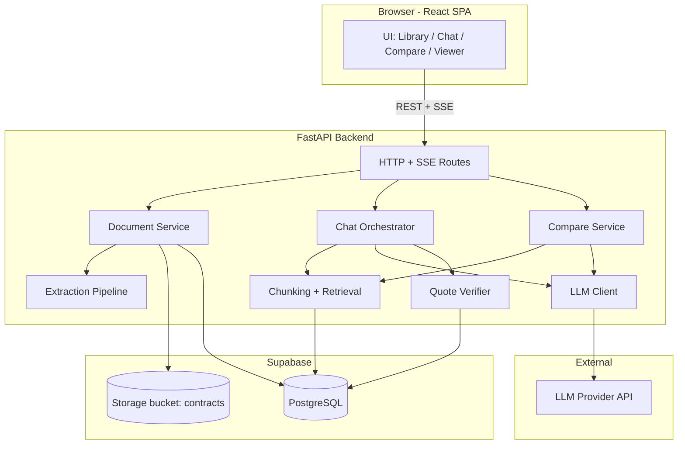
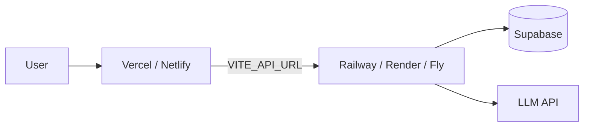
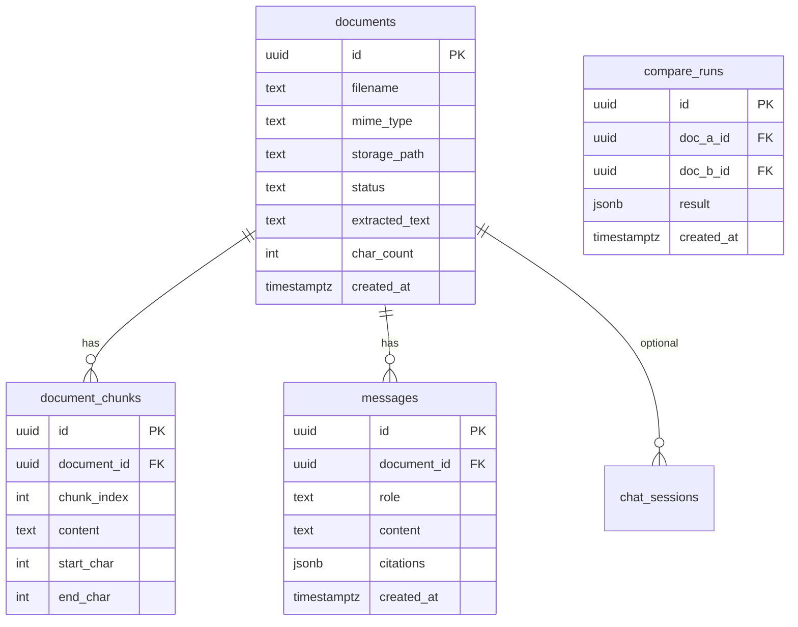
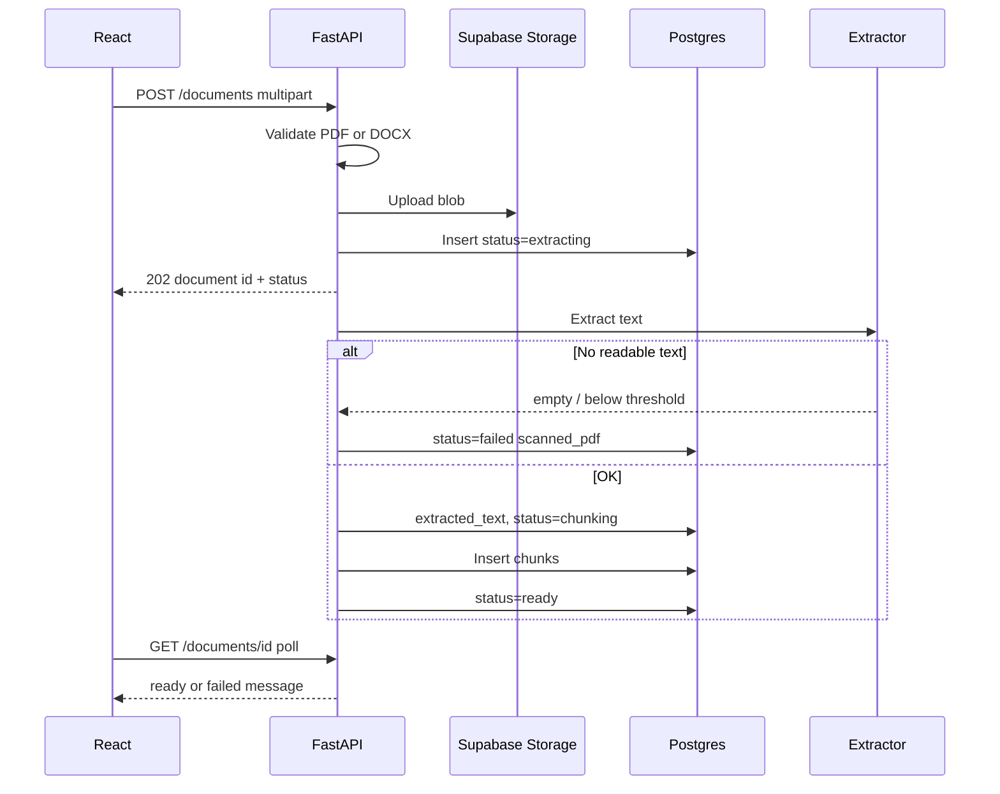
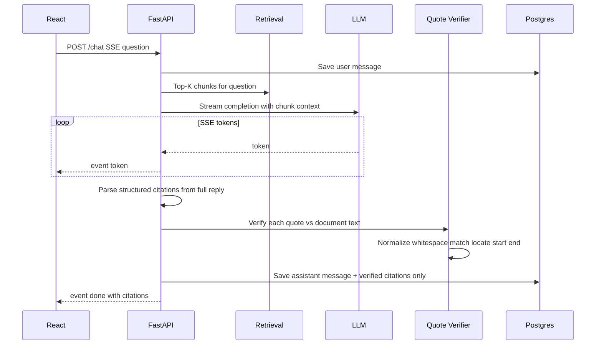
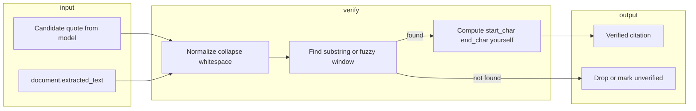
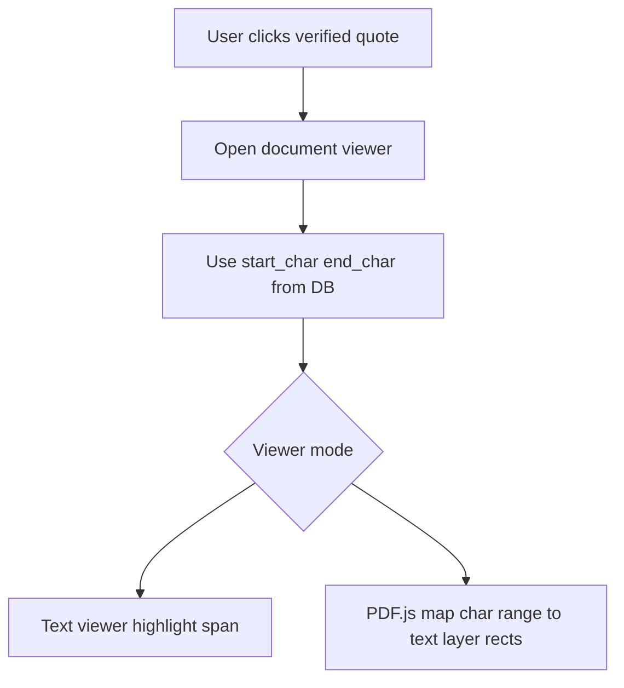
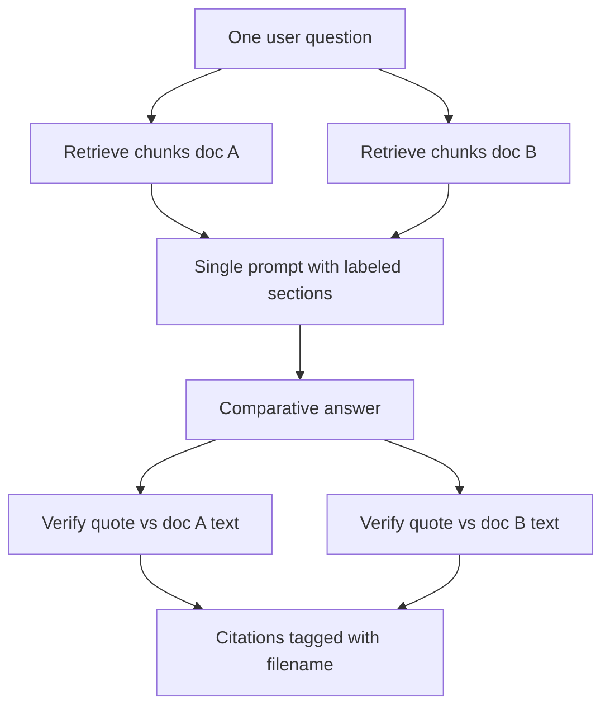
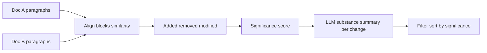
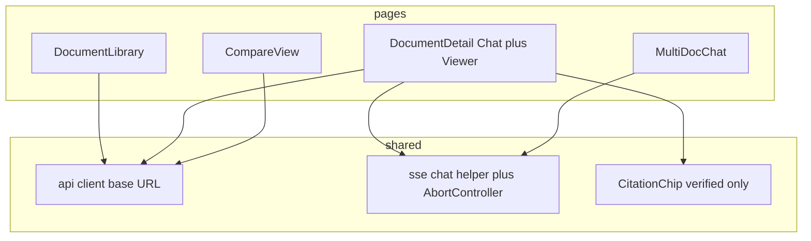

# System Architecture — AI Contract Analyzer

**Stack:** Vite + React (frontend) · FastAPI (backend) · Supabase PostgreSQL (+ Storage) · LLM via environment variables (`OPENAI_API_KEY`, `OPENAI_BASE_URL`, `MODEL_NAME`)

**Constraints:** Single user, no login; answers grounded in documents; every citation verified server-side.

---

## 1. High-level view



**Principle:** The browser talks **only** to FastAPI. FastAPI owns secrets, extraction, retrieval, verification, and streaming. Supabase is persistence (and optional file store), not application logic.

---

## 2. Layer responsibilities

| Layer | Technology | Responsibility |
|--------|------------|----------------|
| **Presentation** | React + Vite | Upload UX, library, streaming chat, stop button, quote chips, document viewer + highlights, multi-select, compare UI |
| **Application API** | FastAPI | Validation, orchestration, SSE, error messages (scanned PDF, wrong file type) |
| **Domain services** | Python modules | Extract text, chunk/index, RAG retrieval, prompt build, parse model output, **verify quotes**, map quotes to offsets |
| **Integration** | httpx / OpenAI SDK | Chat completions with streaming |
| **Persistence** | Supabase Postgres | Documents, text, chunks, messages, compare jobs |
| **Blob storage** | Supabase Storage | Original PDF/DOCX (recommended for deploy) |
| **AI** | Configurable provider | Inexpensive model; no keys in repo or frontend |

---

## 3. Deployment architecture



| Environment | Frontend | Backend | Data |
|-------------|----------|---------|------|
| **Local** | `localhost:5173` | `localhost:8000` | Supabase dev project (or same project) |
| **Prod** | `https://app.example.com` | `https://api.example.com` | Supabase prod project |

**CORS:** FastAPI allows `FRONTEND_URL` only.

**Secrets:** `DATABASE_URL`, `OPENAI_*`, `SUPABASE_SERVICE_ROLE_KEY` — backend host only. Never commit API keys.

---

## 4. Core data model (PostgreSQL)



**Notes**

- **`citations` JSON (assistant messages):** Only **server-verified** entries: `{ quote, document_id, start_char, end_char, verified: true }`. Unverified candidates are dropped or stored with `verified: false` and not shown as real citations in UI.
- **Multi-doc chat:** Add `conversation_id` + `conversation_documents` (many-to-many), or store `document_ids[]` on a `conversations` table; messages link to `conversation_id`.
- **Chunks:** Filled after extraction; used for 150-page retrieval (`start_char` / `end_char` align with quote verification and text viewer).

**Storage bucket:** Path like `{document_id}/{original_filename}`; DB holds `storage_path`.

---

## 5. Backend module structure (logical)

```text
app/
  main.py                 # FastAPI, CORS, lifespan
  config.py               # env settings
  database.py             # SQLAlchemy engine, session
  models/                 # ORM
  schemas/                # Pydantic request/response
  routers/
    documents.py          # upload, list, get, delete, download
    chat.py               # SSE chat, stop via disconnect
    compare.py            # two-doc compare
  services/
    storage.py            # Supabase Storage upload/download
    extract_pdf.py
    extract_docx.py
    chunking.py
    retrieval.py          # keyword / BM25 / embeddings
    llm.py                # stream chat
    prompts.py
    quote_verify.py       # normalize whitespace, locate in extracted_text
    citation_map.py       # char range → viewer (Part B highlight)
    compare.py            # align paragraphs, summarize
```

---

## 6. API surface (REST + SSE)

| Method | Path | Purpose |
|--------|------|---------|
| `POST` | `/documents` | Upload PDF/DOCX → Storage + processing |
| `GET` | `/documents` | Library list |
| `GET` | `/documents/{id}` | Metadata + processing status |
| `GET` | `/documents/{id}/text` | Extracted text (viewer) |
| `GET` | `/documents/{id}/file` | Stream original or signed redirect |
| `DELETE` | `/documents/{id}` | Delete DB + Storage + messages |
| `GET` | `/documents/{id}/messages` | Chat history |
| `POST` | `/documents/{id}/chat` | **SSE** stream answer |
| `POST` | `/chat/multi` | **SSE** multi-document question |
| `POST` | `/compare` | Body: `doc_a`, `doc_b` → clause-level diff + summary |
| `GET` | `/health` | Liveness |

**Upload processing statuses:** `uploading` → `extracting` → `chunking` → `ready` | `failed` (with `error_code`: `unsupported_type`, `scanned_pdf`, `extract_error`).

Frontend polls `GET /documents/{id}` until `ready` / `failed` so the user always sees progress.

---

## 7. Key flows

### 7.1 Document upload and processing



**Scanned PDF rule:** If extracted text length is below threshold (e.g. &lt; 50 chars after strip), **fail** with a clear user message — do not mark `ready`.

---

### 7.2 Chat with streaming, stop, and history



**Stop:** Client closes EventSource / aborts `fetch`; server stops reading LLM stream and persists **partial** assistant text.

**Large docs:** Retrieval returns only K chunks; system prompt requires: *if not in context, say you cannot confirm from the sections searched — do not claim whole-document absence.*

---

### 7.3 Quote verification (central subsystem)



**Rules**

- Ignore model-provided page/offset.
- Allow whitespace/newline differences between quote and source.
- UI never styles unverified text as a trusted citation.

---

### 7.4 Citation highlighting (Part B.5)



**Phased implementation**

1. **MVP:** Extracted-text panel with highlight from `start_char`/`end_char` (matches verifier).
2. **Advanced:** PDF.js text layer mapping; handle multi-line and duplicates (pick match index from verifier).

---

### 7.5 Multi-document chat (Part B.6)



One orchestration path; retrieval and verification are **per document**.

---

### 7.6 Document comparison (Part B.7)



Runs as a **batch job** (sync for small docs, or `compare_runs` + poll). Output is structured JSON for the React compare page — not raw character diff.

---

## 8. Frontend architecture (React)



| Route (example) | Screen |
|-----------------|--------|
| `/` | Library + upload |
| `/documents/:id` | Chat + text/PDF viewer |
| `/multi` | Select docs + chat |
| `/compare` | Pick two versions + results |

**State:** React Query (or simple fetch) for documents; local state for streaming message; server is source of truth for history.

---

## 9. AI integration

| Setting | Source |
|---------|--------|
| API key | `OPENAI_API_KEY` |
| Base URL | `OPENAI_BASE_URL` (OpenRouter, etc.) |
| Model | `MODEL_NAME` |

**Patterns**

- **Structured output:** Ask model for JSON with `answer` + `quotes[]` (each with `document_id` in multi-doc), then verify before sending final `done` event.
- **Or:** Stream plain text, run verification on complete paragraph — still must verify before persisting citations.

**Cost control:** Cap retrieved chunks, max output tokens, compare job limits.

---

## 10. Cross-cutting concerns

| Concern | Approach |
|---------|----------|
| **Errors** | Consistent `{ detail, code }` JSON |
| **Logging** | Request id, document id; no API keys in logs |
| **File limits** | Max upload size on FastAPI + Storage policy |
| **Idempotency** | Optional for upload; delete is cascading |
| **Testing** | Unit tests for `quote_verify.py`; fixture contract text |
| **Future Part C** | Agent tools = new `services/agent.py` router calling same retrieval + quote verifier |

---

## 11. Build order mapped to architecture

| Phase | Architecture pieces |
|-------|---------------------|
| 1 | Deploy topology + FastAPI + Supabase connection + health |
| 2 | Storage + `documents` + upload/extract pipeline |
| 3 | `messages` + single-doc chat SSE + LLM client |
| 4 | `quote_verify` + citation JSON on save |
| 5 | `document_chunks` + `retrieval` + honest partial-context prompts |
| 6 | Text viewer + highlight from char range |
| 7 | Multi-doc router + per-doc verify |
| 8 | Compare service + UI |
| 9 | PDF.js highlight mapping (optional hardening) |

---

## 12. Summary

A **three-tier app**: React SPA → **stateless FastAPI** (except processing jobs) → **Supabase Postgres + Storage**, with **LLM** as an external dependency. The **differentiator** is server-side **quote verification and char-range citations** tied to **chunk-aware retrieval** so long contracts stay honest. Frontend is thin; trust and document logic live in FastAPI.

---

## Assignment scope reference

| Part | Scope |
|------|--------|
| **A** | Upload, library, chat (stream + stop + history), verified quotes, large-document retrieval with honest partial answers |
| **B** | Citation highlighting, multi-document chat, clause-level comparison |
| **C** | Choose one: tracked-change DOCX redlining **or** agentic document research with tools |
